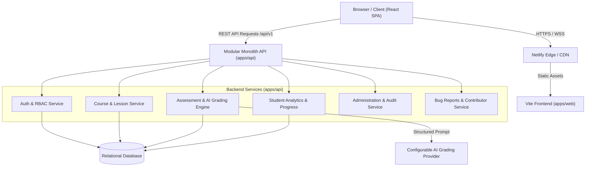
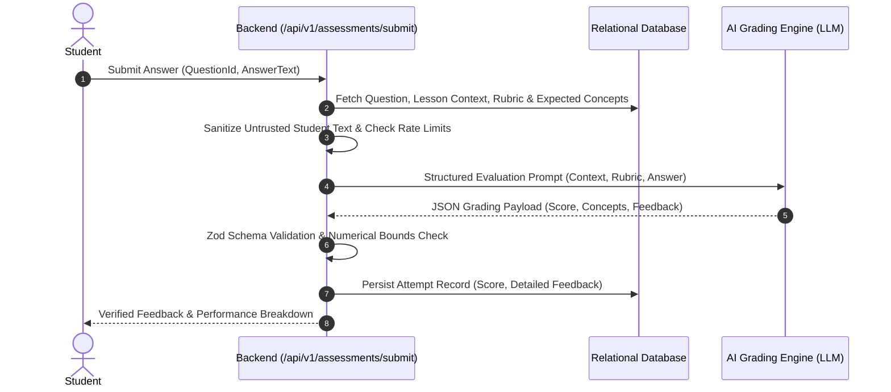

# ESP8266 Security Lab — System Architecture

**Document Version:** 1.0.0  
**Target Environment:** Production Monorepo  

---

## 1. High-Level Architectural Overview

The **ESP8266 Security Lab** is designed as a **modular monolith** within a Turborepo monorepo, pairing a high-performance React Single Page Application (SPA) with a resilient, layered Node.js/Express REST API.



---

## 2. Frontend Architecture (`apps/web`)

### Tech Stack
- **Framework**: React 18 + Vite 5 (ESM).
- **Styling**: Tailwind CSS with custom Cybersecurity Dark Theme palette:
  - Background (Deep Navy): `#080F1C`
  - Secondary Surface: `#101B2D`
  - Elevated Cards/Dialogs: `#142238`
  - Primary Accent (Cyan): `#35D5F2`
  - Secondary Accent (Electric Blue): `#528BFF`
  - Foreground Text: `#F3F7FC`
  - Muted Text: `#9AAAC0`
  - Borders: `#1F314D`
- **Component Primitives**: shadcn/ui pattern with Lucide React icons.
- **Client Routing**: React Router v6.
- **State & Data Fetching**: Typed fetch clients with Zod validation.

### Directory Structure
```text
apps/web/src/
├── assets/          # Static images, hardware diagrams, SVGs
├── components/      # Reusable UI primitives (buttons, inputs, cards, dialogs)
│   ├── layout/      # Navbar, Sidebar, Footer, Responsive Wrappers
│   └── ui/          # Tailwind/shadcn component atoms
├── context/         # AuthContext, ThemeContext, CourseContext
├── pages/           # Routed application views
│   ├── landing/     # Public marketing & curriculum preview page
│   ├── auth/        # Login, Register, Forgot Password
│   ├── dashboard/   # Student learning workspace & analytics
│   ├── lessons/     # 3-pane interactive lesson reader
│   ├── assessments/ # Knowledge assessment submission & review
│   └── admin/       # Administrator course CMS & grading oversight
├── services/        # API client modules
└── types/           # Shared TypeScript interfaces
```

---

## 3. Backend Architecture (`apps/api`)

### Tech Stack
- **Runtime**: Node.js v20+ / v24.
- **HTTP Framework**: Express 4 with TypeScript.
- **Validation**: Zod runtime schema validation on all request bodies, queries, and AI responses.
- **Security**: Helmet, CORS, Cookie-Parser, rate limiting, and bcryptjs password hashing.
- **API Spec**: Versioned endpoints mounted at `/api/v1`.

### Modular Layering
Each domain module contains:
1. **Routes (`*.routes.ts`)**: Defines endpoint paths and attaches auth/validation middlewares.
2. **Controller (`*.controller.ts`)**: Handles HTTP status codes, extracts validated payloads, and dispatches to services.
3. **Service (`*.service.ts`)**: Encapsulates business logic, database transactions, and data manipulation.
4. **Validation Schemas (`*.schema.ts`)**: Zod schemas for incoming requests and outgoing payloads.

```text
apps/api/src/
├── config/          # Environment variables, database connection, AI config
├── middleware/      # Authentication, RBAC, error handling, rate limiting
├── modules/
│   ├── auth/        # Register, login, session tokens, password reset
│   ├── courses/     # Modules, lessons, hardware requirements, curriculum
│   ├── progress/    # Completed lessons, reading status, time spent
│   ├── assessments/ # Questions, rubrics, submissions, attempt history
│   ├── ai-grading/  # AI prompt orchestration and Zod response validation
│   ├── analytics/   # Performance indicators, strengths & weaknesses
│   ├── reports/     # Bug reports, documentation errata, applications
│   └── admin/       # CMS operations, grade overrides, user management
└── index.ts         # Application entry point
```

---

## 4. AI Assessment Engine Architecture

The AI Assessment Engine is designed for high reliability, strict scoring fairness, and anti-injection security:



### Rubric Weighting Standard
- **Technical Accuracy (35%)**: Factual precision regarding networking and hardware.
- **Conceptual Understanding (30%)**: Grasp of underlying architectural implications.
- **Completeness (20%)**: Addressing all components of the prompt.
- **Practical Application (15%)**: Real-world relevance and defensive mindset.

---

## 5. Database & Relational Storage Model

The persistence layer is structured for full MariaDB / MySQL compatibility:
- Relational foreign key constraints with `CASCADE` or `RESTRICT` rules.
- Explicit indexes on lookup columns (`user_id`, `lesson_id`, `question_id`, `created_at`).
- Normalized tables for users, roles, courses, modules, lessons, submissions, and feedback.
- Embedded relational data engine during local development and automated CI testing.

---

## 6. Defensive Security & Zero-Trust Design

1. **Authentication**: Signed JSON Web Tokens (JWT) stored in HTTP-only, SameSite cookies.
2. **Authorization**: Strict Role-Based Access Control (**Student**, **Contributor**, **Administrator**).
3. **Data Sanitization**: All incoming markdown and answers are escaped to prevent Cross-Site Scripting (XSS).
4. **Prompt Injection Defense**: Student inputs are treated as untrusted strings, isolated within delimited XML/JSON tags in the LLM prompt context with explicit system instructions to ignore prompt overrides.
